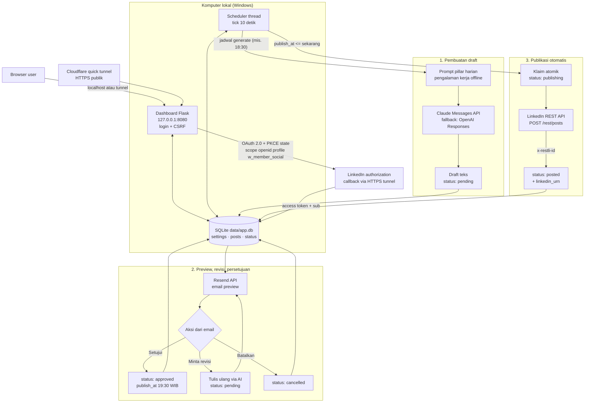
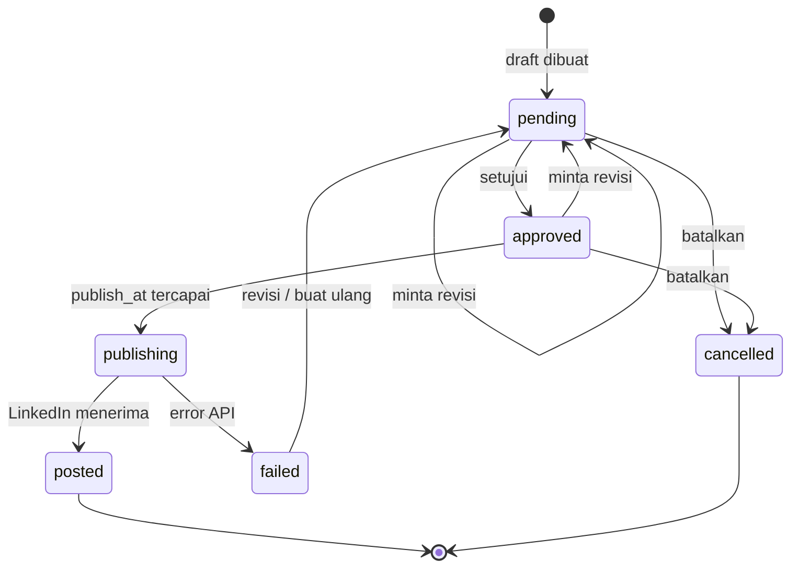

# Arsitektur aplikasi lokal (LinkedIn Auto-Post)

Aplikasi Python/Flask yang berjalan di komputer sendiri. Draft dibuat terjadwal oleh AI,
dikirim ke email untuk ditinjau, boleh direvisi, dan **hanya terbit ke LinkedIn setelah disetujui**.

## Alur status draft

## Catatan

- Semua jadwal memakai WIB (UTC+7), tanpa DST.
- Tidak ada draft yang terbit tanpa status `approved`; scheduler mengklaim draft secara atomik
  agar tidak ada post ganda.
- Kredensial (API key, access token) disimpan di database lokal atau file `*_key.txt` yang
  tidak ikut di-commit.
